<div align="center">

# CustomFramework

**A secure, real-time, tab-based web application framework in Go and plain JavaScript.<br>Any business logic on top, an interface people enjoy using all day.**


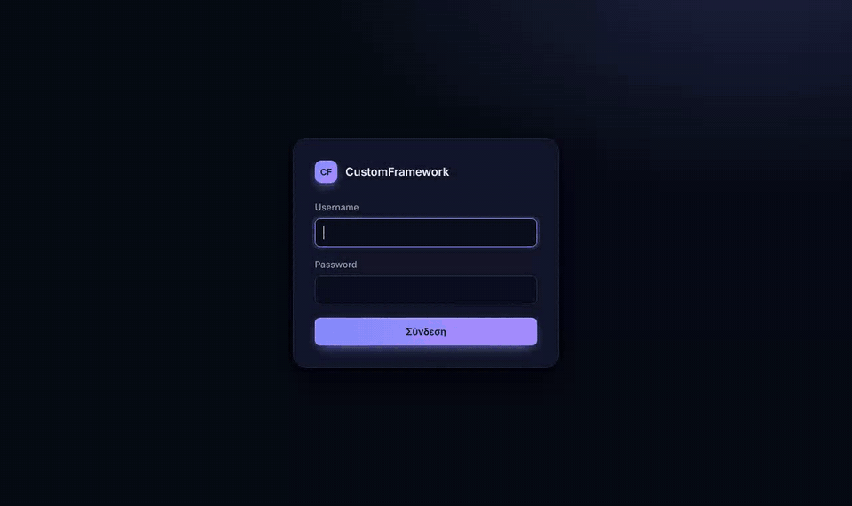

</div>

> This repository is a showcase. The framework's source code is private.
> The screenshots show the example app, whose interface is in Greek.

---

## In three lines

- **Built for real-time systems.** Live data reaches the screen over WebSocket
  the moment it changes: prices, positions, payments, queues, alerts. Screens
  that are hidden show a badge, and the realtime link reconnects by itself.
  It can also hand realtime over to a dedicated high-throughput server.
- **Any business logic.** The framework knows nothing about your domain. A
  CRM, a trading back office, a payment desk, an iGaming console, a support
  tool: each is a set of modules with its own screens, actions, permissions
  and data. The framework provides the workspace, the security and the plumbing.
- **Very user friendly.** It behaves like a desktop application. Tabs, groups
  and split view; nothing is lost on a refresh, a sleep or an expired session;
  keyboard shortcuts, touch support, dark and light themes.

## Why

Back-office tools (CRMs, trading and payment operations, support desks) are used
for hours at a time, in dozens of screens, with sensitive data. Most web
frameworks treat each page as a fresh start and leave security to each team.

CustomFramework turns this around:

- **The workspace is the product.** The app has its own tabs, inside one
  browser window: groups, split view, pinned tabs, pop-out windows, and
  tabs that remember their state.
- **Security is not optional.** One endpoint, one pipeline. Every request is
  signed, used once, typed and permission-checked before any business code
  runs. The secure path is the only path.

## Features

### A workspace built around tabs

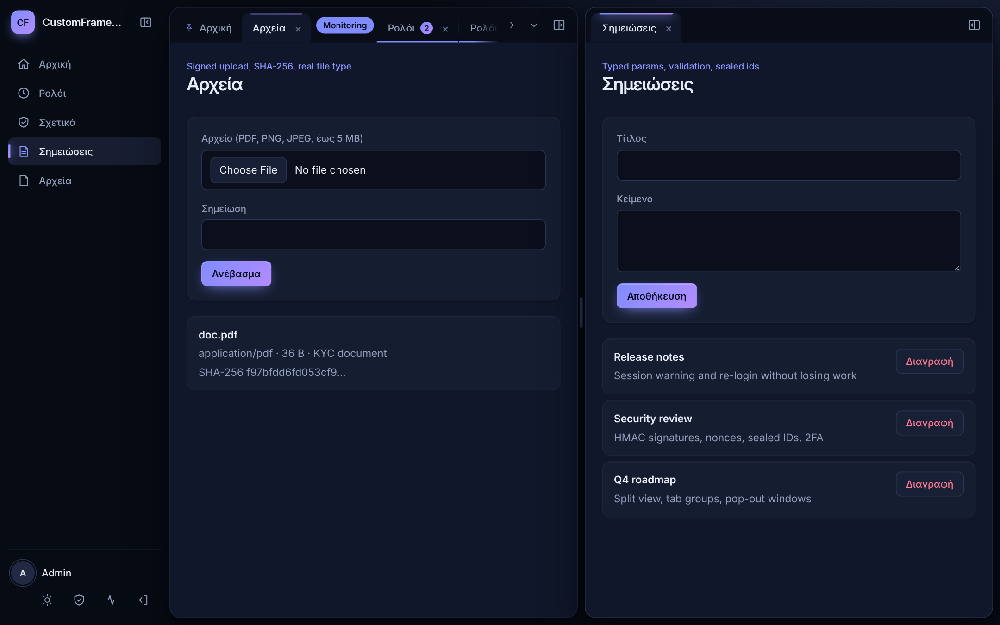

| | |
|---|---|
| **Split view** | Compare two screens side by side. Drag a tab to the right, resize the divider, move tabs between the sides. |
| **Tab groups** | Name, color, fold and unfold. Drag a tab in or out of a group. |
| **Pinned tabs** | Always first, compact, cannot be closed by accident. |
| **Badges** | A screen shows "3 new" on its tab while it is hidden. |
| **Sleeping tabs** | Tabs left hidden release their memory and requests, then reload when opened. |
| **Saved screen state** | Filters, scroll position and drafts survive sleep, refresh, duplicate and pop-out. |
| **Workspace restore** | After a refresh, or a new login in the same browser tab, the same tabs come back. Only the visible ones load. |
| **Unsaved changes guard** | Closing a screen with unsaved work asks first, using an in-page dialog. |
| **Pop-out windows** | Move a screen to its own window, e.g. a second monitor, and back. |
| **Deep links** | Every screen has a link, the Back/Forward buttons work, and a link waits for the login. |
| **One app window** | The app runs in one browser tab. A second one offers "use it here" and hands over all open tabs. |
| **Keyboard and touch** | `Alt+W`, `Alt+PgUp/PgDn`, `Alt+1…9`; long-press opens the tab menu on phones and tablets. |
| **Many tabs** | Fading edges, scroll arrows, and a searchable list of all tabs. |
| **Layouts and themes** | Sidebar or top navigation, dark and light theme. |

<table>
<tr>
<td width="50%">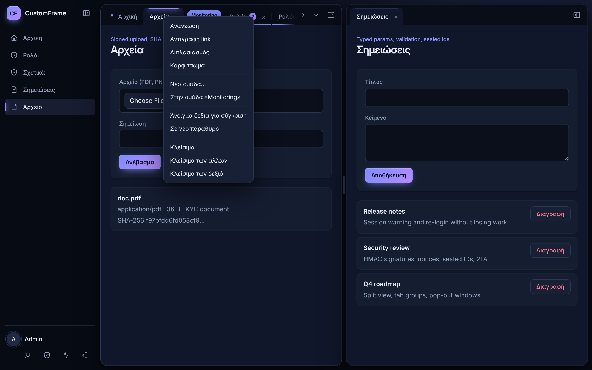<br><sub>Right-click menu on a tab</sub></td>
<td width="50%">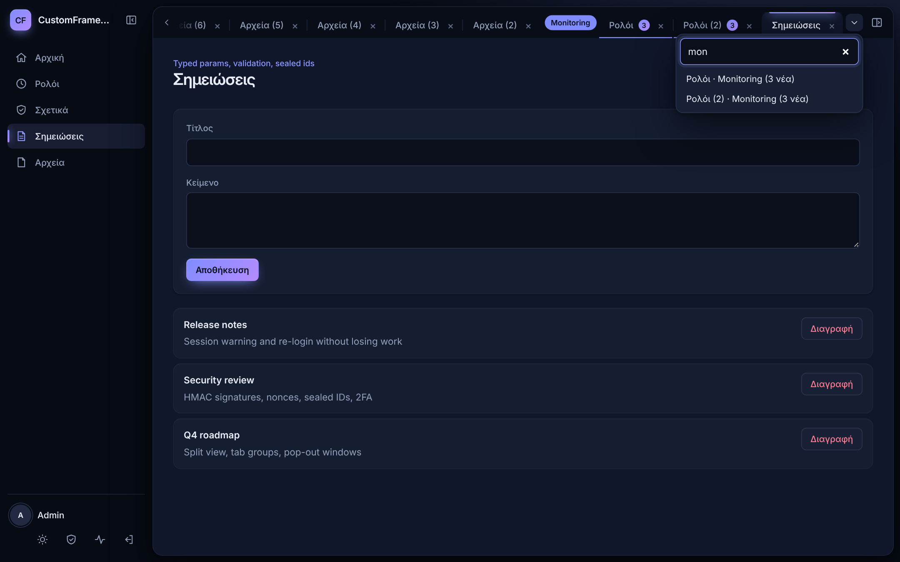<br><sub>Find one of 30 tabs by typing</sub></td>
</tr>
<tr>
<td>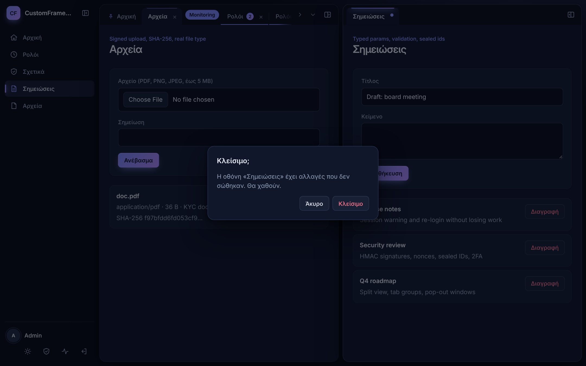<br><sub>Unsaved work is never lost by a click</sub></td>
<td>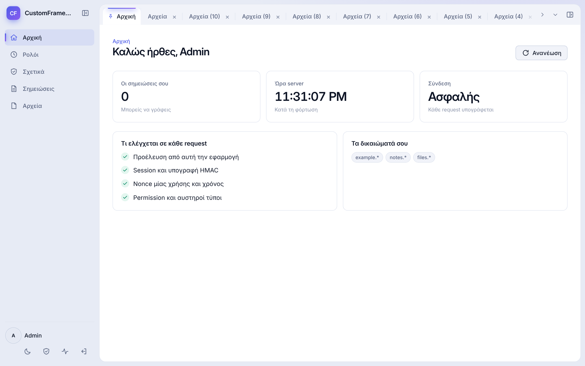<br><sub>Light theme</sub></td>
</tr>
</table>

### Security in every request

```mermaid
flowchart LR
    B["Browser<br/>(plain JS core)"] -->|"POST /api<br/>HMAC-SHA256 signature<br/>timestamp · one-time nonce"| P

    subgraph P["One pipeline, in this order"]
        direction TB
        o["Origin check"] --> f["Forged-request block per IP"]
        f --> s["Session"] --> sig["Signature · clock · nonce"]
        sig --> r["Rate limit"] --> d["Decrypt (optional)"]
        d --> j["Strict JSON, typed params"] --> perm["Permission"]
        perm --> v["Validation"]
    end

    v --> H["Module handler"]
```

- **Signed requests.** HMAC-SHA256 over method, path, time, nonce and body.
  The key is sent once inside the page and never stored in a cookie.
- **No replays.** Each nonce works once (shared through PostgreSQL across servers).
  Timestamps must be within ±60 s.
- **Sealed values.** IDs given to the browser are encrypted and bound to the
  session and to a purpose (AES-256-GCM). They cannot be read, changed or reused.
- **Strict, typed parameters.** Unknown fields, duplicate keys and wrong types are refused.
  Every handler gets a validated Go struct.
- **Optional payload encryption** on top of TLS, so bodies are unreadable in
  the network panel and in inspecting proxies.
- **Two-factor login (TOTP).** QR setup, 10 one-time recovery codes. Optional,
  required for everyone, or required for chosen users (for example administrators).
- **Active sessions.** Users see where they are signed in and can end other sessions.
- **Session expiry without lost work.** A countdown before the end. After it, the
  user logs in again in a small window and the app goes on where it was.
- **Hardened defaults.** Strict CSP with Trusted Types, HSTS, SameSite=Strict and
  `__Host-` cookies, CSRF tokens, Argon2id passwords, login rate limits, TLS or
  Let's Encrypt built in, or behind nginx with trusted proxies. The server refuses
  to start with an unsafe configuration.

<table>
<tr>
<td width="50%">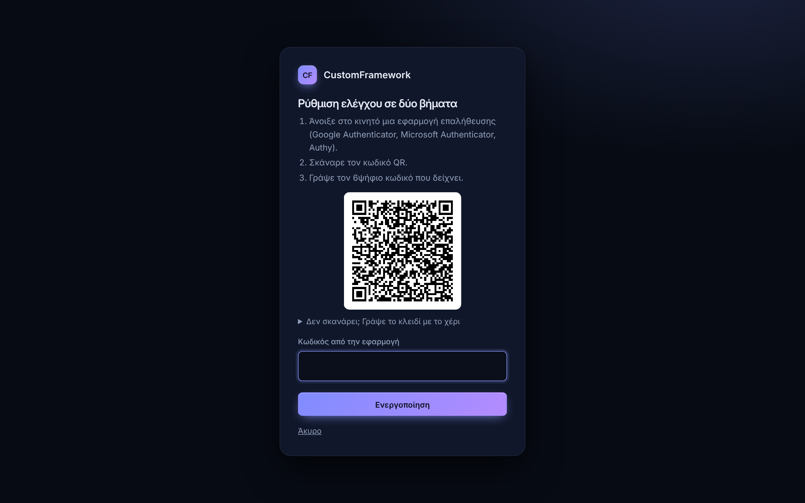<br><sub>2FA setup: QR code generated on the server</sub></td>
<td width="50%">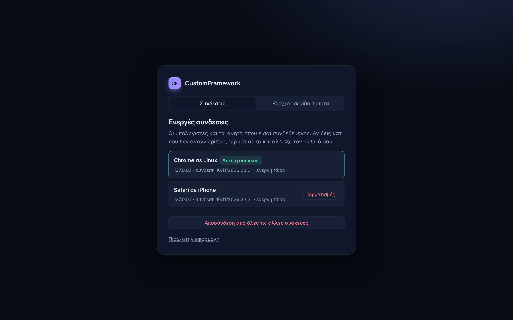<br><sub>Active sessions, sign out of other devices</sub></td>
</tr>
<tr>
<td>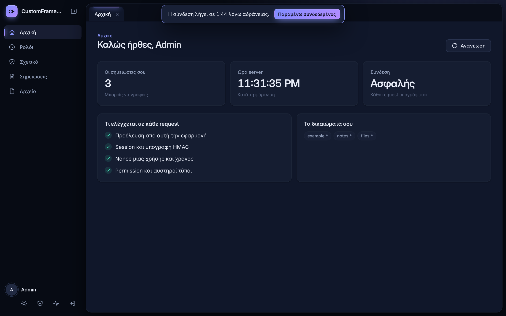<br><sub>Warning before the session ends</sub></td>
<td>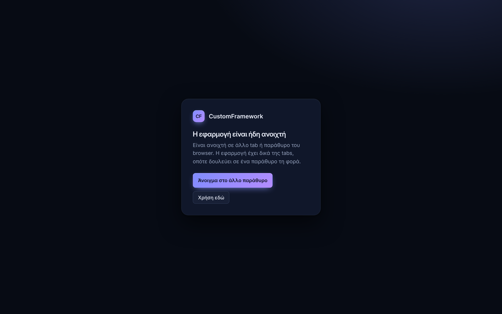<br><sub>One app window per browser</sub></td>
</tr>
</table>

### Real time, and talking to other systems

- **Realtime over WebSocket** (RFC 6455, written on the standard library). A
  screen subscribes to topics such as `prices.EURUSD` or `client.1042`. The
  server pushes events only to the users allowed to see them. One-time tickets,
  automatic reconnect with backoff, optional encryption of every event, and one
  shared connection for all tabs. For very high volumes, realtime can move to an
  external server (for example a C++ broadcast server) that uses the same tickets.
- **Recurring requests** for data that is polled. They pause by themselves while
  their tab is hidden and refresh the moment it is shown again.
- **External API, inbound** (`POST /ext`). API clients with HMAC signatures,
  scopes, IP allow-lists and per-client rate limits.
- **External API, outbound.** Calls to other services with a host allow-list,
  no redirects, private-IP blocking at dial time (against SSRF and DNS
  rebinding), timeouts, retries and response size limits.
- **File uploads** through the same signed pipeline. The signature covers the
  file's SHA-256. The type is detected from the content, not the name, and nothing
  reaches the disk before every check has passed.

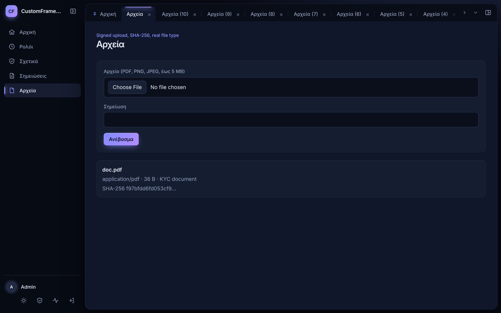

### For developers

```go
framework.AddTarget(m, framework.Target[SaveInvoice]{
    Name:       "save",
    Permission: "invoices.write",
    Handle: func(c *framework.Context, p SaveInvoice) (any, error) {
        // p is already parsed, typed and validated; the user is allowed.
        id, err := insertInvoice(c.Context(), db, c.Identity.UserID, p)
        if err != nil {
            return nil, err
        }
        ref, err := c.Seal("invoices.invoice", id) // the browser gets an opaque, session-bound reference
        return map[string]any{"ref": ref}, err
    },
})
```

```js
const result = await this.context.requestTarget('save', { amount: 1500, note: 'May' });
// Signing, clock correction, encryption, retries and cleanup are handled by the framework.
```

- **Your logic, your modules.** Each module brings its own routes, templates,
  components, styles and permissions. The framework stays the same for every product.
- Components get a `context`. Whatever is started through it is cleaned up when the tab closes:
  requests, timers, recurring polls and realtime subscriptions.
- A built-in memory monitor, a minified and obfuscated production build of the
  browser core, and a Debian deployment guide.

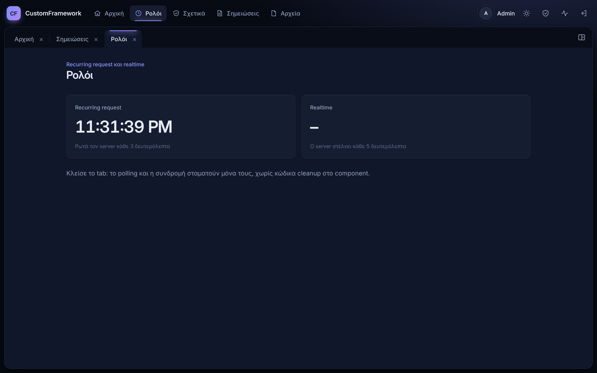

## Under the hood

| | |
|---|---|
| Server | Go, standard library only (plus `x/crypto` for Argon2id and Let's Encrypt, and `pgx` for PostgreSQL) |
| Browser | Plain JavaScript modules, no framework, no build step in development |
| Sessions | In memory, or PostgreSQL shared by several servers |
| Size | about 6,400 lines of Go, 5,200 of JavaScript, and 3,300 lines of Go tests |
| Testing | Go tests with the race detector; browser end-to-end tests for every feature |

## About

Designed and built by **George Drakou**, software engineer in Nicosia, Cyprus,
with 20+ years in web platforms, CRM systems for forex brokers, and Linux.

The source code is private. If you would like a walkthrough or a live demo,
contact me through [GitHub](https://github.com/george-cd) or LinkedIn.

<sub>© George Drakou. All rights reserved. Screenshots and text may be shared with a link to this page.</sub>
